# PRD: Avara, B2B Distributor Assistant (Tech Stack & Integration Specification)

**Version:** 2.1
**Status:** Approved for build, with the decisions in §13 still open
**Date:** 2026-11-20
**Supersedes:** v2.0
**Change from v2.0:** v2.1 closes the gaps found when the landing page was checked against v2.0. It adds:

- **Channel-based tenant resolution.** A new `channels` table maps WhatsApp numbers to tenants (FR-1.6).
- **Orders / POs** as a first-class entity, with a `lookup_order` tool (FR-2.1, §8).
- **A server-side approval gate.** The LLM cannot bypass it (FR-7).
- **Data onboarding and export.** CSV import of parties, orders and open balances, plus CSV export for the customer's ERP (FR-8).
- **Usage metering and a cost model.** These respond to Meta's per-message pricing for service and utility messages, effective 2026-10-01 (FR-9).
- **Data protection requirements** under UU PDP (Law 27/2022), including a subprocessor register (FR-10).
- **Schema fixes:**
  - Invoice numbers are now unique per tenant and drawn from a per-tenant sequence.
  - `invoice_line_items` now carries `tenant_id`.
  - The outbox now has its own table.
  - DOKU notifications are signature-verified at the ingestor before they reach Inngest.
- **A claims register** that ties each public marketing claim to the requirement behind it (§16).

v2.0 already moved orchestration from Redis/BullMQ to **Inngest**, and that decision is unchanged.

---

## 1. Product summary

A multi-tenant B2B assistant that sits between a distributor's back office and its trading partners. It accepts inbound WhatsApp messages and initiates outbound conversations. It writes to business data (orders, invoices, payment status), generates invoice PDFs, ingests supplier documents via OCR, and reconciles payments through DOKU. The assistant is a **transactional agent with write access to business records**. Reliability of tool execution and idempotency of side effects are product requirements, not engineering nice-to-haves.

**System of record.** Avara keeps its own operational records (orders, invoices, payments, documents) in Supabase. It runs **alongside** the distributor's ERP or accounting system, not inside it. Data enters through CSV import, and leaves through CSV export or, later, connectors (FR-8). v1 does not write directly into third-party ERPs.

**Definitions.**
- **Tenant:** one distributor legal entity and its RLS boundary.
- **Channel:** one WhatsApp Business phone number that belongs to a tenant. It usually maps to a branch or a product line, and a tenant may have several.
- **Party:** an external counterparty (customer or supplier).

**Primary personas:** Distributor ops staff (including finance/AR), B2B customers, supplier/related parties.
**Primary channels:** WhatsApp (inbound + outbound), web dashboard (auth, configuration, approvals, audit).

### 1.1 Product context at a glance

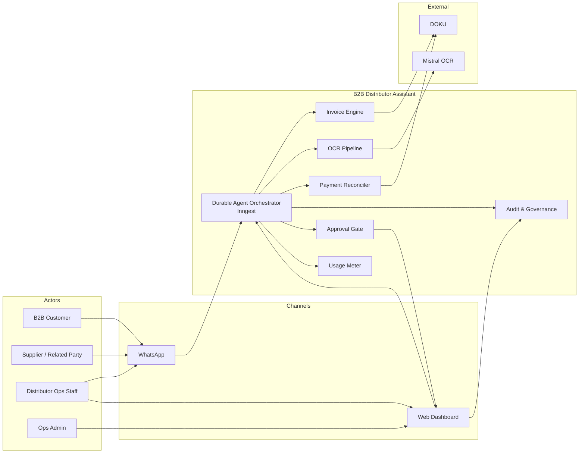

---

## 2. Goals and non-goals

| Goals | Non-goals (v1) |
|---|---|
| Handle inbound WhatsApp queries with a durable, tool-calling agent | Voice / telephony channel |
| Generate and deliver invoice PDFs with database-enforced unique numbering | Full accounting ledger / ERP replacement |
| Ingest supplier invoices via OCR into validated structured records | Custom OCR model training |
| Accept DOKU payments (VA, QRIS, e-wallet) and reconcile webhooks idempotently | Multi-currency settlement beyond IDR |
| Tenant-isolated data with auditable access | Per-tenant dedicated database clusters |
| Initiate outbound chat (payment reminders, document requests) | Marketing broadcast / bulk campaigns |
| Survive mid-workflow failures without losing progress or duplicating side effects | Exactly-once delivery from WhatsApp (provider delivers at-least-once) |
| Require human approval above tenant-defined thresholds before side effects (FR-7) | Direct write connectors into third-party ERPs (Accurate, Jurnal, SAP B1) in v1 |
| Onboard tenant data by CSV import and hand it back by CSV export (FR-8) | Per-tenant region pinning; prod runs in one Supabase region |
| Meter every billable unit per tenant so pricing covers WhatsApp, LLM and OCR cost (FR-9) | SSO / SAML for dashboard login in v1 |

---

## 3. Personas and jobs-to-be-done

| Persona | JTBD | Interaction mode |
|---|---|---|
| Distributor ops | "When a customer asks for an invoice, I want it generated and sent without leaving WhatsApp." | Inbound chat → tool call → PDF → send |
| Finance / AR (ops sub-role) | "I want payment status I can trust without chasing screenshots, and to approve anything large before it goes out." | Dashboard approvals + reconciled payments + CSV export |
| B2B customer | "I want to know my outstanding balance and pay without a phone call." | Inbound chat → balance lookup → payment link |
| Supplier / related party | "I need to submit an invoice and get confirmation it was received." | Inbound document → OCR → structured record → confirmation |
| Ops admin | "I need to see every agent action and intervene when something fails." | Dashboard + audit log + human handoff |

---

## 4. Functional requirements

### FR-1: Inbound message handling (WhatsApp)

| ID | Requirement | Priority |
|---|---|---|
| FR-1.1 | Verify `X-Hub-Signature-256` (HMAC-SHA256 with App Secret) on every webhook POST **before** any processing; reject unsigned or mismatched payloads | P0 |
| FR-1.2 | Return HTTP 200 within **500ms** of receipt; hand off to Inngest and acknowledge immediately. Meta’s timeout is strict, and direct coupling to heavy work causes retry floods and quality-rating demotion | P0 |
| FR-1.3 | Deduplicate on WhatsApp message ID (`wamid`) using Inngest’s **event-level idempotency** (`id: wamid`); at-least-once delivery makes duplicates a guarantee | P0 |
| FR-1.4 | Route message to main agent or subagent based on intent classification, executed as a durable Inngest step | P0 |
| FR-1.5 | Support text, image, document, and interactive (button/list) message types | P1 |
| FR-1.6 | Resolve the tenant from `entry.changes.value.metadata.phone_number_id` via the `channels` table **before** sending the Inngest event; put `tenant_id` and `channel_id` in the event payload. Webhooks for an unknown `phone_number_id` are acknowledged with 200 (to stop retries), logged, and not processed | P0 |
| FR-1.7 | Resolve or create the `party` from the sender's phone number within the resolved tenant. A new number is created as `type = unknown` and the conversation is limited to read-only tools until ops classifies it | P1 |

### FR-2: Durable agent orchestration (DeepSeek + Inngest)

| ID | Requirement | Priority |
|---|---|---|
| FR-2.1 | Main agent uses DeepSeek API with tool calling; tools include `lookup_order`, `create_invoice` (takes `order_id`, not free-form line items), `lookup_balance`, `initiate_payment`, `ingest_document`, `escalate_to_human`. There is **no** approval tool: approval is enforced by the orchestrator (FR-7), not requested by the model | P0 |
| FR-2.2 | **Each LLM call and each tool execution runs as an independent Inngest `step.run()`**, so a failure on tool call N does not re-execute or re-bill tool calls 1 to N-1 | P0 |
| FR-2.3 | **Buffer complete tool-call invokes before parsing**; do not execute partial or streamed tool calls. DeepSeek V3.2/V4 streaming can corrupt `function.arguments` for nested arrays, producing syntactically invalid calls without raising an exception; this fired for **4 to 6% of tool-bearing requests** in production | P0 |
| FR-2.4 | Validate every tool call against a JSON schema before execution. On validation failure: fail closed, log to `agent_actions`, and retry the **LLM step only** (not the already-successful steps) via Inngest’s step-level retry | P0 |
| FR-2.5 | Keep tool schemas shallow; avoid deeply nested array parameters, the specific shape that triggers serialization corruption | P0 |
| FR-2.6 | Maintain conversation context across turns, persisted per tenant + per external party | P1 |
| FR-2.7 | **Escalation rule (closes v2.0 Q4):** if schema validation fails twice for the same turn, the Inngest `onFailure` handler sets `conversations.state = needs_human`, writes `agent_actions.status = escalated`, notifies ops in the dashboard, and sends the party a fixed holding message ("Tim kami akan membalas sebentar lagi"). The agent stops acting on that conversation until a human releases it | P0 |
| FR-2.8 | Every mutating tool passes through the approval gate (FR-7) **after** schema validation and **before** its side-effect step | P0 |

### FR-3: Invoice generation and delivery

| ID | Requirement | Priority |
|---|---|---|
| FR-3.1 | Generate invoice PDF from structured data (not free-text tenant HTML) | P0 |
| FR-3.2 | **Use html2pdf.js ≥ 0.14.0 only**, or replace with an isolated Chromium-free renderer. Versions prior to 0.14.0 contain CVE-2026-22787 (DOM XSS; invoice generators explicitly affected) | P0 |
| FR-3.3 | Render PDFs in an **isolated Inngest step with no outbound network access** and no application credentials; sanitize tenant-controlled HTML with DOMPurify before rendering | P0 |
| FR-3.4 | Enforce invoice number uniqueness at the **database level** with `UNIQUE (tenant_id, invoice_number)`, not in application logic. A global unique key is wrong in a multi-tenant schema: tenant A's `INV-0001` would block tenant B's | P0 |
| FR-3.5 | Deliver generated PDF via WhatsApp document message and persist in Supabase Storage | P1 |
| FR-3.6 | Allocate invoice numbers from a per-tenant `invoice_sequences` row, locked with `SELECT … FOR UPDATE` inside the same transaction as the invoice `INSERT`. This yields sequential numbers without a "regenerate and retry" loop. Format (prefix, year, padding) is tenant-configurable | P0 |

### FR-4: Document ingestion (Mistral OCR)

| ID | Requirement | Priority |
|---|---|---|
| FR-4.1 | Accept supplier invoice uploads via WhatsApp document message | P0 |
| FR-4.2 | Run OCR → structured extraction (line items, totals, tax ID, invoice number) → schema validation → persistence. **Do not pass raw OCR text directly into agent context** | P0 |
| FR-4.3 | Use Mistral Batch API where latency permits; pricing is **$2/1,000 pages standard, $1/1,000 pages batch** | P1 |
| FR-4.4 | Store original file + OCR output + extracted structured record for audit | P0 |
| FR-4.5 | If OCR validation fails, route to `documents.ocr_status = needs_review` and trigger human escalation **without retrying the OCR step indefinitely** | P0 |

### FR-5: Payments (DOKU)

| ID | Requirement | Priority |
|---|---|---|
| FR-5.1 | Obtain B2B access token via OAuth 2.0 with **SHA256withRSA** asymmetric signature (15-minute token) | P0 |
| FR-5.2 | Sign transactional requests with **HMAC-SHA512** `X-SIGNATURE` over the SNAP `stringToSign` | P0 |
| FR-5.3 | Include unique `X-EXTERNAL-ID` per request; use it as the idempotency key on the DOKU side | P0 |
| FR-5.4 | Treat DOKU payment webhook as the **source of truth** for payment state; never rely on agent memory for payment success | P0 |
| FR-5.5 | Make webhook handler idempotent on `partnerReferenceNo` / `X-EXTERNAL-ID` using Inngest event/function idempotency **and** a database uniqueness constraint | P0 |
| FR-5.6 | Support VA, QRIS, and e-wallet; surface payment instructions into the WhatsApp thread | P1 |
| FR-5.7 | DOKU payment notifications arrive at a **Node ingestor endpoint**, which verifies the notification signature over the raw body **before** sending the Inngest event. DOKU never posts directly to Inngest. The inbound verification scheme (key type and `stringToSign`) is taken from DOKU's SNAP notification spec, not assumed to be the same as the outbound HMAC-SHA512 scheme in FR-5.2 (see §13 Q9) | P0 |
| FR-5.8 | A tenant runs on the DOKU **sandbox** until its live merchant credentials are active. The dashboard shows the payment mode per tenant, and the agent tells the party when a payment link is a test link | P0 |

### FR-6: Outbound initiation

| ID | Requirement | Priority |
|---|---|---|
| FR-6.1 | Agent can initiate WhatsApp conversation when a trigger fires (invoice due, missing document, payment confirmation) | P0 |
| FR-6.2 | Respect WhatsApp template/message-window rules; outbound initiation outside the 24-hour window requires an approved template | P0 |
| FR-6.3 | Rate-limit outbound initiation per tenant and per recipient using **Inngest throttling keyed on `tenant_id`** to prevent one tenant from starving others; add a second throttle keyed on `channel_id` to stay inside each number's Meta messaging limit | P0 |
| FR-6.4 | Outbound sends go through the `outbound_messages` outbox table (`queued → sending → sent / unknown / failed`). Do **not** retry WhatsApp sends blindly (there is no native idempotency key on sends). A send that times out after the request left our process is marked `unknown` and goes to human review. It is never resent automatically | P0 |
| FR-6.5 | Before each outbound send, record its expected Meta pricing category (marketing / utility / service) on the outbox row; reconcile it with the `pricing` object on Meta status webhooks (FR-9.2) | P1 |

### FR-7: Approval gate

| ID | Requirement | Priority |
|---|---|---|
| FR-7.1 | Tenants define `approval_rules` by action type (`create_invoice`, `initiate_payment`, outbound template send), amount threshold (IDR), and optionally party or party group | P0 |
| FR-7.2 | The gate is evaluated **server-side by the orchestrator** inside a `step.run("approval-check")`, after schema validation and before the side-effect step. The LLM cannot see, skip or satisfy it. Rule evaluation is deterministic code, not a prompt | P0 |
| FR-7.3 | When a rule matches, insert an `approvals` row (`pending`) and suspend the run with `step.waitForEvent("approval.decided", { match: "data.approval_id", timeout: tenant setting, default 24h })`. The party gets a holding message | P0 |
| FR-7.4 | Approvers act in the dashboard. Only `memberships.role IN ('owner','approver')` can decide, and the decision is enforced by RLS plus a `security definer` function. Every decision records approver, timestamp and reason | P0 |
| FR-7.5 | On timeout, the action is cancelled (never auto-approved), the party is told it is still being reviewed, and ops is alerted | P0 |
| FR-7.6 | Default for new tenants: **every** `create_invoice` and `initiate_payment` requires approval until the tenant sets thresholds. Safe by default during the pilot | P1 |

### FR-8: Data onboarding and export

| ID | Requirement | Priority |
|---|---|---|
| FR-8.1 | Dashboard CSV import for `parties`, `orders` (PO number, party, amount, line items, due date), and opening balances. Each import is an Inngest function with row-level validation and a downloadable error report | P0 |
| FR-8.2 | Imports are idempotent on the tenant's external reference (`parties.external_ref`, `orders.order_ref`): a re-uploaded file updates rows rather than creating duplicates | P0 |
| FR-8.3 | Opening balances are stored as `invoices` with `created_via = import` so that `lookup_balance` has one calculation path | P1 |
| FR-8.4 | CSV export of invoices, payments and supplier documents (extracted fields) by date range, so finance can load them into its ERP. Column mapping presets per ERP are a later addition | P1 |
| FR-8.5 | v1 does not sync with ERPs. Marketing copy must say Avara runs **alongside** the ERP, not inside it (§16) | P0 |

### FR-9: Usage metering and cost model

Meta now charges per message for WhatsApp service messages and for utility templates sent inside the 24-hour customer service window, effective **2026-10-01**. Both were previously free. Meta also charges the same rate whether a person or a third-party AI writes the reply. Every agent reply therefore costs money. Source: Meta, *Pricing for non-template messages* (developers.facebook.com/documentation/business-messaging/whatsapp/pricing/non-template-messages).

| ID | Requirement | Priority |
|---|---|---|
| FR-9.1 | Write a `usage_events` row per billable unit: WhatsApp message delivered (with category), LLM tokens in/out per call, OCR pages, PDF renders, Inngest function runs. Tag every row with `tenant_id` and `channel_id` | P0 |
| FR-9.2 | Use the `pricing` object on Meta message status webhooks as the source for WhatsApp billable status and category; check field names against current Meta docs at build time | P0 |
| FR-9.3 | Dashboard shows month-to-date usage and estimated pass-through cost per tenant; alert at 80% of any plan allowance | P1 |
| FR-9.4 | Pricing must keep a platform fee separate from WhatsApp message fees (passed through at cost, or bundled up to an allowance). The commercial choice is open (§13 Q10), but the metering in FR-9.1 is required either way | P0 |
| FR-9.5 | Plan limits are expressed in **handled requests** (one inbound party request taken to a terminal state), not in Meta "conversations", which Meta no longer bills by | P1 |

### FR-10: Data protection (UU PDP)

| ID | Requirement | Priority |
|---|---|---|
| FR-10.1 | Keep a subprocessor register (Supabase, Inngest, DeepSeek, Mistral, Meta, DOKU, Cloudflare) with processing location and purpose, published on the Data Processing page | P0 |
| FR-10.2 | Legal records the basis for cross-border transfer of personal data to each processor outside Indonesia before the first live tenant (§13 Q11) | P0 |
| FR-10.3 | Minimize what is sent to the LLM: send structured fields (party display name, order refs, amounts) rather than raw document text or full history; never send bank or card numbers | P0 |
| FR-10.4 | Tenant-level data export and deletion on request, with deletion logged in `agent_actions` | P1 |

---

## 5. Tech stack: final decisions

| Layer | Technology | Decision | Binding constraint |
|---|---|---|---|
| **Dashboard / auth client** | Cloudflare Pages | ✅ Adopt | Pages Functions run on the **Workers runtime, not full Node.js**. Do not run PDF rendering, Puppeteer, or heavy Node libraries inside Pages Functions. Treat Pages as auth + light CRUD shell |
| **Database** | Supabase (Postgres) | ✅ Adopt | Single-region; accept latency trade-off. RLS is the tenant boundary, not an option. Use `tenant_id` on every tenant-owned table + `memberships` + `security definer` helper with pinned `search_path`. Since 2026-10-30, new tables need explicit grants before Data API access |
| **Main agent LLM** | DeepSeek API | ⚠️ Adopt with wrapper | Tool-call corruption rate requires buffering + schema validation + fail-closed. Inngest provides step-level retry so a failed tool call does not re-run earlier successful calls |
| **Durable orchestration** | **Inngest** | ✅ **Adopt (replaces Redis/BullMQ)** | Functions are HTTP endpoints in your existing Node.js app; no worker fleet to operate. Idempotency at event and function level (24h dedupe), per-tenant concurrency/throttle keys, step-level retries, and dashboard observability |
| **WhatsApp integration** | Cloud API (subagent) | ⚠️ Adopt with mandatory verification + Inngest handoff | 3 to 15s webhook timeout depending on Meta config; at-least-once delivery; no native idempotency on outbound sends. **Since 2026-10-01 service messages and in-window utility templates are billed per message**, so every agent reply has a Meta cost (FR-9) |
| **OCR** | Mistral OCR 3 | ✅ Adopt | Purpose-built for invoice/form extraction; $2/1k pages standard, $1/1k batch. Structured extraction pipeline, not raw OCR → LLM |
| **PDF rendering** | Node.js + html2pdf.js (≥0.14.0) | ⚠️ Adopt only isolated / replace | CVE-2026-22787 in <0.14.0; SSRF/file-read risk from tenant HTML even in fixed versions. Run as an isolated Inngest step with egress restrictions |
| **Payments** | DOKU SNAP BI | ✅ Adopt | RSA-SHA256 token + HMAC-SHA512 transaction signatures + idempotent webhook handling |

### 5.1 Why Inngest over Redis/BullMQ or Cloudflare Queues

| Requirement | Redis/BullMQ | Cloudflare Queues | **Inngest** |
|---|---|---|---|
| Durable execution across deploys/crashes | Manual (job state in Redis; worker restart risk) | Partial | **Native**: each step is memoized and resumable |
| Step-level retry without re-running earlier steps | Manual | Manual | **Native**: only the failed step retries |
| Event/function idempotency | Manual table + TTL | Manual | **Native 24h dedupe** at event and function level |
| Per-tenant concurrency/throttle | Manual key design | Manual | **Native `key` expression** on concurrency and throttle |
| Webhook ingestion without custom receiver | Manual queue add | Pull/push to Workers only | **Webhook transforms + event hub** |
| Operational surface | Redis + workers + monitoring | Queues + Workers + DLQ | **No worker fleet**; HTTP endpoints in existing Node app |
| Free tier | OSS (self-host cost) | $5 base + ops | **50k executions/month, 500k events**, sufficient for pilot |
| Cost at scale | Infra + engineer time | Low per-op | Pro from ~$99/mo, usage-based beyond |

**Decision:** Inngest is the better stack for this product because the workload is **multi-step, side-effecting, and must survive partial failure**. A raw queue gives you at-least-once job delivery; it does **not** give you durable step state, step-level retry isolation, or per-tenant fairness. Inngest provides all three without adding a worker fleet, and its HTTP-based model fits both the Node.js service and a future Cloudflare Workers deployment.

**Alternative considered:** Trigger.dev is a strong second choice for Node.js-native long-running tasks and self-hosting, but it introduces its own compute runtime and worker deployment model; Inngest’s “functions in your existing app” model is a smaller operational delta from the current stack. Temporal is over-engineered for this scope at v1 and requires operating workers plus server/DB if self-hosted.

### 5.2 Stack layering view

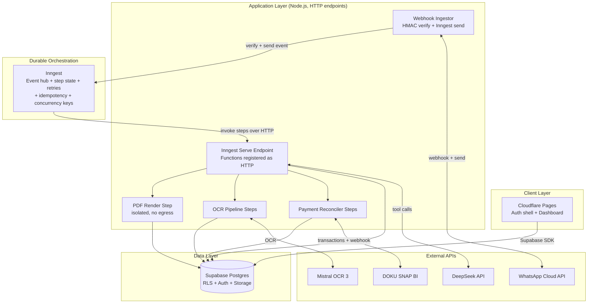

---

## 6. Integration architecture

### 6.1 Runtime topology

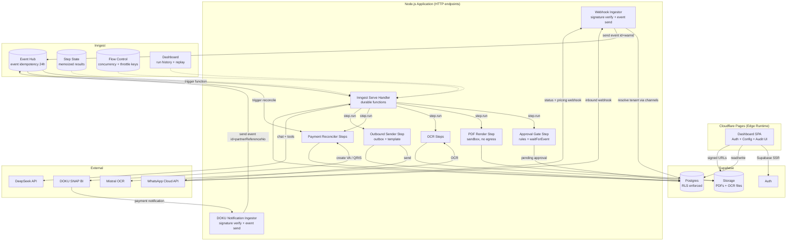

### 6.2 External integration contract register

| Integration | Direction | Auth / verification | Idempotency key | Failure handling |
|---|---|---|---|---|
| WhatsApp inbound webhook | Meta → us | HMAC-SHA256 `X-Hub-Signature-256` with App Secret; **raw body required** for digest | `wamid` as Inngest event `id` (24h dedupe) | Return 200 immediately; Inngest retries function on failure |
| WhatsApp outbound send | us → Meta | Bearer token | **No native idempotency key**. `outbound_messages` outbox row id, correlated to the returned `wamid`; do not blind-retry | `unknown` state → human review; never auto-resend |
| WhatsApp status webhook | Meta → us | Same HMAC verification as inbound | `wamid` + status | Updates `outbound_messages` status and writes `usage_events` from the `pricing` object (FR-9.2) |
| DeepSeek chat completion | us → DeepSeek | API key | Request UUID (app-side) | Buffered tool calls; schema validation; Inngest retries the **LLM step only** |
| DeepSeek tool execution | internal | N/A (app-side) | `tool_call_id` | Fail closed; never execute malformed call |
| Mistral OCR | us → Mistral | API key | Document hash + page range | Batch where latency allows; Inngest step retry with backoff |
| DOKU access token | us → DOKU | RSA-SHA256 (private key) → Bearer | N/A (short-lived token) | Refresh before 15-min expiry; cache token |
| DOKU transaction | us → DOKU | HMAC-SHA512 `X-SIGNATURE` | `X-EXTERNAL-ID` | Unique per request per day; never reuse |
| DOKU payment notification | DOKU → Node ingestor → Inngest | SNAP notification signature verified at the ingestor over the raw body (scheme per DOKU spec, §13 Q9); reject before any event is sent | `partnerReferenceNo` / `X-EXTERNAL-ID` as Inngest event `id` **and** DB UNIQUE constraint | Inngest idempotency + DB uniqueness; DB is source of truth |
| CSV import | Dashboard → us | Supabase Auth session + RLS | `tenant_id` + `external_ref` / `order_ref` | Row-level error report; partial success allowed |

---

## 7. Key flows

### 7.1 Inbound message → durable agent → response

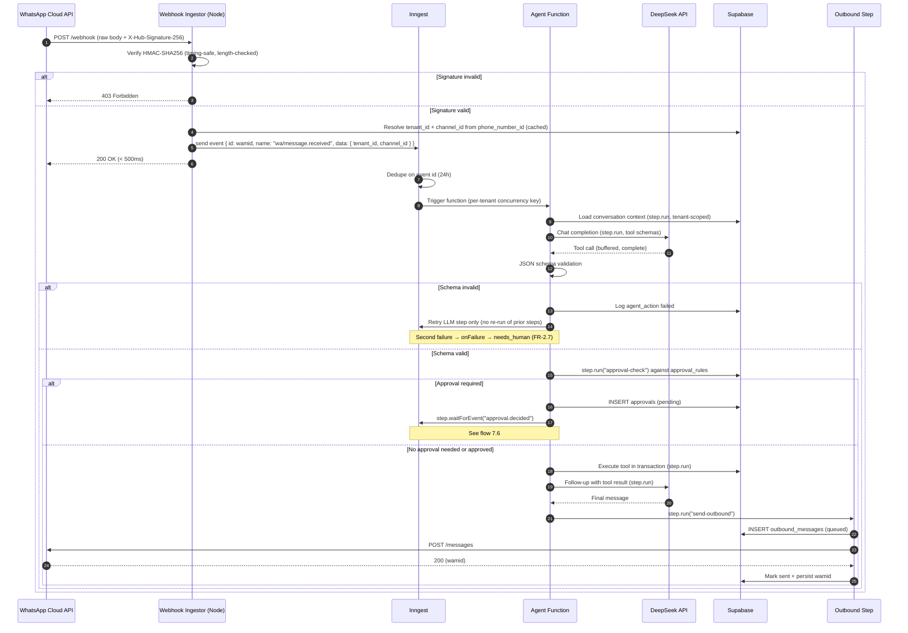

### 7.2 Invoice generation (isolated PDF render as durable step)

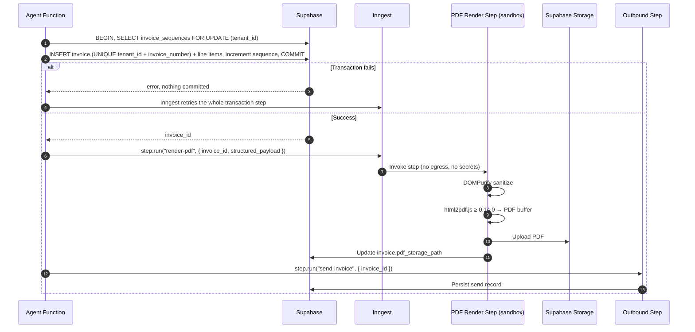

### 7.3 Document ingestion via OCR

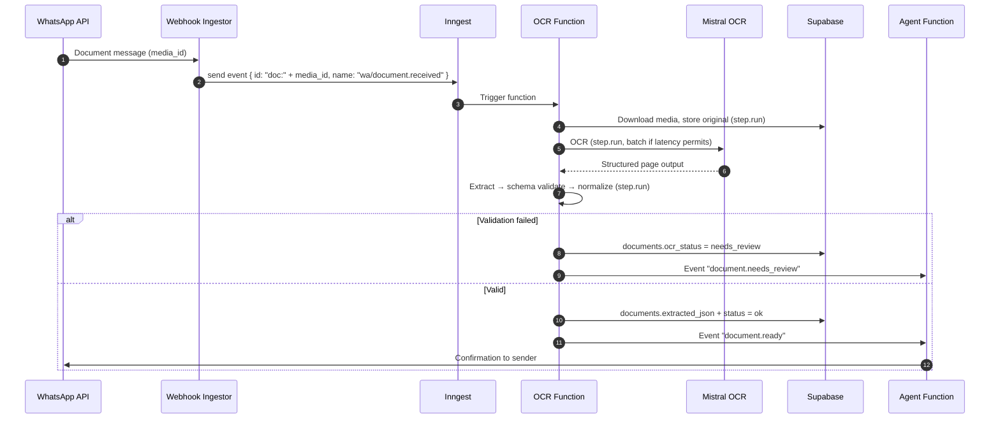

### 7.4 Payment flow (DOKU)

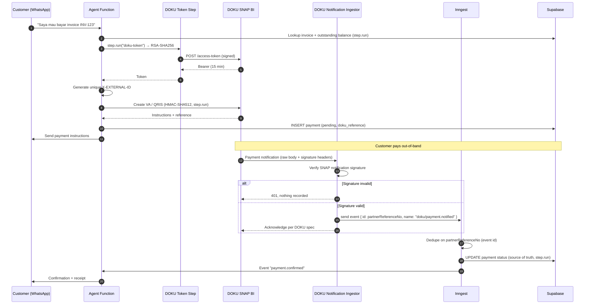

### 7.5 Outbound initiation (per-tenant throttle)

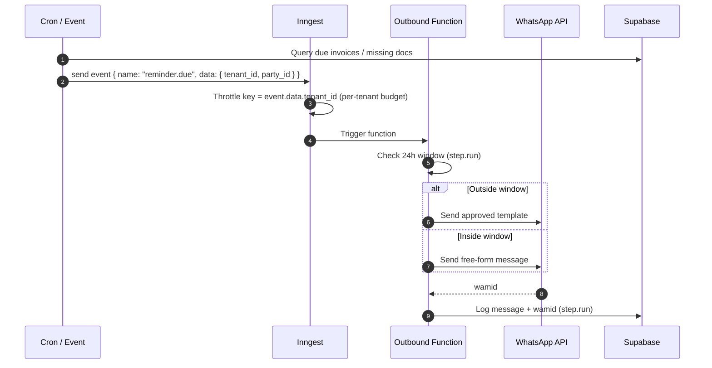

### 7.6 Approval gate

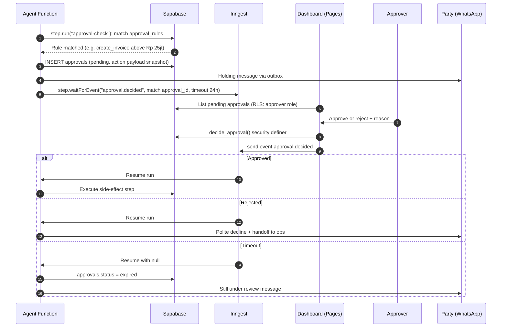

### 7.7 Data onboarding (CSV import)

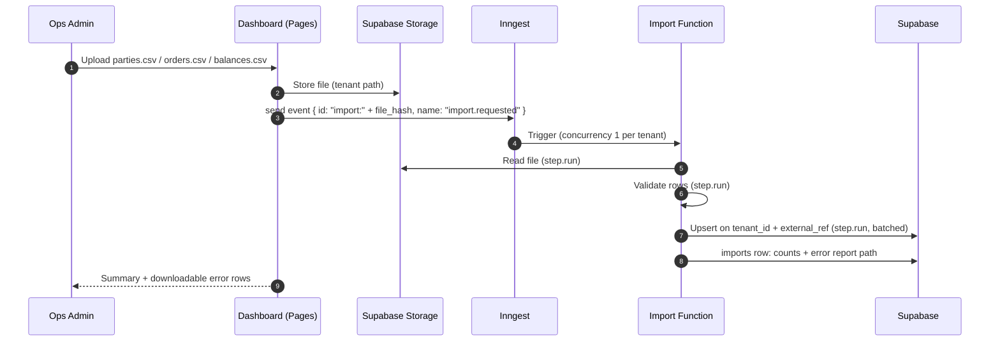

---

## 8. Data model (minimum viable)

All tenant-owned tables carry `tenant_id` and are protected by RLS. That includes child tables such as `invoice_line_items`, so every policy uses the same pattern without joins.

### 8.1 Entity-relationship diagram

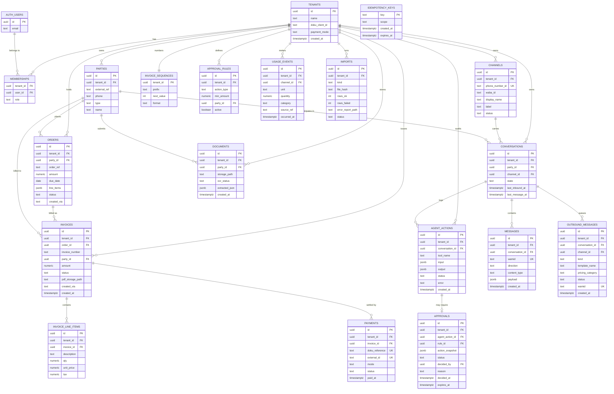

### 8.2 Table summary

| Table | Key columns | Notes |
|---|---|---|
| `tenants` | `id`, `name`, `doku_client_id`, `payment_mode` (`sandbox` / `live`) | One row per distributor legal entity |
| `memberships` | `tenant_id`, `user_id`, `role` (`owner` / `approver` / `ops` / `viewer`) | Maps auth users → tenants; index on `user_id` |
| `channels` | `tenant_id`, `phone_number_id` **UNIQUE**, `waba_id`, `display_name`, `label` | **New in v2.1.** One row per WhatsApp number; used by the ingestor to resolve the tenant (FR-1.6) |
| `parties` | `tenant_id`, `external_ref`, `phone`, `type` (customer / supplier / unknown), `name` | `UNIQUE (tenant_id, external_ref)` and `UNIQUE (tenant_id, phone)` |
| `conversations` | `tenant_id`, `party_id`, `channel_id`, `state`, `last_inbound_at`, `last_message_at` | `last_inbound_at` drives the 24h window check (FR-6.2) |
| `messages` | `tenant_id`, `conversation_id`, `wamid`, `direction`, `content_type`, `payload` | `wamid` unique index for dedupe |
| `outbound_messages` | `tenant_id`, `conversation_id`, `channel_id`, `kind`, `template_name`, `pricing_category`, `status`, `wamid` | **New in v2.1.** The outbox required by FR-6.4 |
| `orders` | `tenant_id`, `party_id`, `order_ref`, `amount`, `due_date`, `line_items`, `status`, `created_via` | **New in v2.1.** `UNIQUE (tenant_id, order_ref)`; PO numbers the party quotes in chat resolve here |
| `invoices` | `tenant_id`, `order_id`, `invoice_number`, `party_id`, `amount`, `status`, `pdf_storage_path`, `created_via` | **`UNIQUE (tenant_id, invoice_number)`**, changed from a global unique key in v2.0 |
| `invoice_sequences` | `tenant_id` PK, `prefix`, `next_value`, `format` | **New in v2.1.** Row-locked during invoice insert (FR-3.6) |
| `invoice_line_items` | `tenant_id`, `invoice_id`, `description`, `qty`, `unit_price`, `tax` | `tenant_id` **added in v2.1** so RLS needs no join |
| `payments` | `tenant_id`, `invoice_id`, `doku_reference` **UNIQUE**, `external_id` **UNIQUE**, `mode`, `status`, `paid_at` | Reconciled from DOKU notification; `mode` records sandbox vs live |
| `documents` | `tenant_id`, `party_id`, `storage_path`, `ocr_status`, `extracted_json` | OCR audit trail |
| `agent_actions` | `tenant_id`, `conversation_id`, `tool_name`, `input`, `output`, `status`, `error` | Full audit of every tool execution |
| `approval_rules` | `tenant_id`, `action_type`, `min_amount`, `party_id` (nullable), `active` | **New in v2.1.** FR-7.1 |
| `approvals` | `tenant_id`, `agent_action_id`, `rule_id`, `action_snapshot`, `status`, `decided_by`, `reason`, `decided_at`, `expires_at` | **New in v2.1.** Snapshot freezes what the approver saw |
| `usage_events` | `tenant_id`, `channel_id`, `unit`, `quantity`, `category`, `source_ref`, `occurred_at` | **New in v2.1.** FR-9.1; `UNIQUE (unit, source_ref)` so a replayed webhook is not double-metered |
| `imports` | `tenant_id`, `kind`, `file_hash`, `rows_ok`, `rows_failed`, `error_report_path`, `status` | **New in v2.1.** FR-8.1 |
| `idempotency_keys` | `key`, `scope`, `created_at`, `expires_at` | Defense-in-depth alongside Inngest idempotency |

**RLS pattern (mandatory):** `tenant_id = ANY (ARRAY (SELECT private.my_tenant_ids()))` with `my_tenant_ids()` as `security definer`, pinned `search_path`, and `to authenticated` on every policy. The `ARRAY(...)` wrapper forces single evaluation per statement; without it, membership-based policies have taken minutes on 1M-row tables. Approval decisions go through `private.decide_approval()` (`security definer`), which checks the caller's role in `memberships`.

---

## 9. Non-functional requirements

Every target below is a **design target until Phase 7 load testing verifies it**. Public copy may describe these as targets or as how the system is built (§16), not as measured results, until the "Verified" column is filled.

| Category | Requirement | Target | Verified |
|---|---|---|---|
| **Webhook availability** | WhatsApp webhook must return 200 within Meta’s timeout under 3× normal load | p99 < 500ms | Pending (Phase 7) |
| **Agent response** | User-perceived first response in WhatsApp | < 8s p95 (may be a “processing” acknowledgement followed by async result) | Pending |
| **Tool-call integrity** | Malformed tool calls executed | **0%**, fail closed | Pending |
| **Invoice uniqueness** | Duplicate invoice numbers within a tenant | 0 under concurrency | Pending |
| **Approval enforcement** | Side effects executed above a matching threshold without an approved `approvals` row | **0**, tested in CI | Pending |
| **Payment reconciliation** | DOKU notification processed within | < 60s p99 | Pending |
| **PDF isolation** | PDF render step has no outbound internet access | Enforced by network policy | Pending |
| **Audit retention** | `agent_actions` and `messages` retained | ≥ 12 months | Pending |
| **Tenant isolation** | Cross-tenant data leakage | Prevented by RLS; tested in CI | Pending |
| **Workflow durability** | In-flight workflows survive deploy/crash | **100%**; Inngest resumes at last successful step | Pending |
| **Metering completeness** | Billable WhatsApp messages without a `usage_events` row, checked monthly against Meta invoice | < 0.5% | Pending |

---

## 10. Security requirements

1. **Webhook signature verification is non-negotiable.** WhatsApp uses HMAC-SHA256 with App Secret; reject unsigned or mismatched payloads before any DB write. Use `express.raw({ type: '*/*' })` so the digest is computed over the exact bytes Meta signed; `timingSafeEqual` must be length-checked to avoid a `RangeError` crash.
2. **DOKU outbound signatures.** For requests we send, implement SNAP `stringToSign` exactly (HTTP method + endpoint + access token + lowercase SHA-256 body hash); HMAC-SHA512 with client secret.
3. **DOKU inbound notifications.** Verify at the Node ingestor before any event reaches Inngest (FR-5.7). Use the notification scheme from DOKU's SNAP spec; do not reuse the outbound scheme by assumption.
4. **PDF renderer must be sandboxed.** Run as an isolated Inngest step with no outbound network, no mounted secrets, read-only filesystem except the output temp dir. Tenant HTML must be sanitized with DOMPurify before rendering.
5. **RLS is the tenant boundary.** Application-level `WHERE tenant_id = ...` filters are defense-in-depth, not the primary control.
6. **Secrets management.** DeepSeek API key, Mistral API key, WhatsApp App Secret, DOKU private key + client secret, Supabase service-role key, and Inngest signing key must be stored in a secret manager (Cloudflare secrets / container secret store / Supabase Vault), never in code or committed `.env`.
7. **Private key handling for DOKU.** RSA private key signs access-token requests; rotate on a schedule and never expose to the Pages/dashboard layer.
8. **Audit everything mutating.** Every tool execution writes to `agent_actions` with input, output, status, and error. This is how you detect the silent DeepSeek tool-call failures described in FR-2.3.
9. **Approval gate is code, not prompt.** Rules are evaluated in an orchestrator step the model cannot influence. Approval decisions are written only through `private.decide_approval()`, which checks the approver role.
10. **Data minimization to processors.** Follow FR-10.3; prompts and OCR requests carry only the fields needed for the step.

---

## 11. Reliability model (Inngest)

### 11.1 Durable execution lifecycle

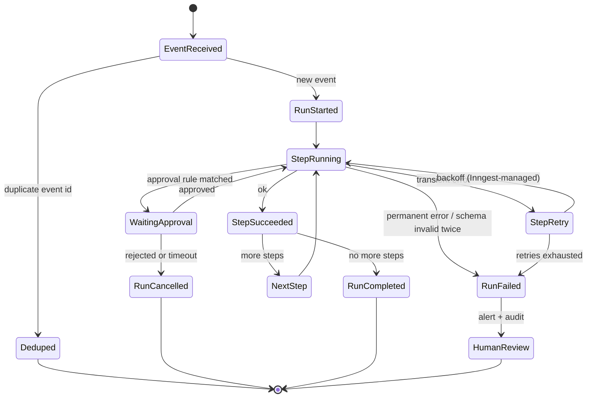

| Concern | How Inngest handles it | App-side responsibility |
|---|---|---|
| **Event dedupe** | Event `id` suppresses duplicate triggers for 24h | Set `id` = `wamid` / `partnerReferenceNo` / `import:file_hash` |
| **Function idempotency** | `idempotency` expression prevents a second run for the same business key within 24h | Use for payment confirmation functions |
| **Step retry** | Failed step retries with backoff; **successful prior steps are memoized and not re-executed** | Make each step a single side effect |
| **External idempotency** | Inngest cannot guarantee external APIs are idempotent; a step can succeed and fail before the result is recorded | Pass `X-EXTERNAL-ID` to DOKU; `wamid` correlation to WhatsApp; `UNIQUE (tenant_id, invoice_number)` |
| **Human-in-the-loop** | `step.waitForEvent` suspends a run without holding compute, with a timeout | Approval rows, dashboard decision, timeout = cancel (FR-7) |
| **Per-tenant fairness** | Concurrency and throttle accept a `key` expression | Key on `event.data.tenant_id` for all agent/outbound functions; add `channel_id` throttle for outbound |
| **Observability** | Inngest dashboard shows run history, step inputs/outputs, and supports replay | Alert on failed runs and DLQ-equivalent exhausted retries |
| **Outbound WhatsApp** | No native idempotency on sends | `outbound_messages` outbox; do not blind-retry; `unknown` → human review |

### 11.2 Retry state machine (per function)

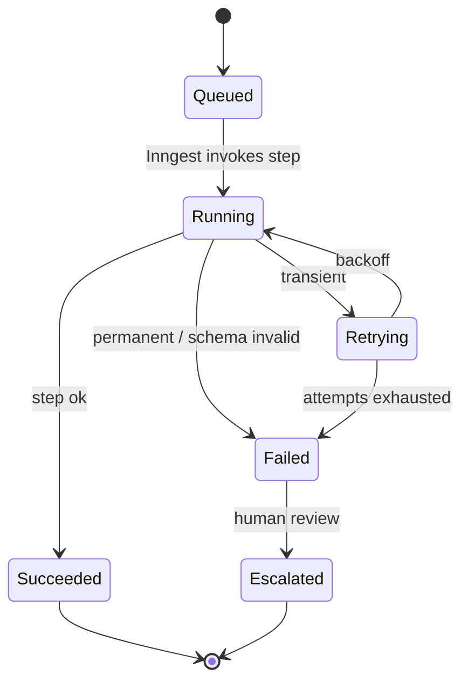

---

## 12. Deployment topology

```mermaid
flowchart LR
    subgraph Dev["Dev"]
        D1[Pages preview]
        D2[Supabase dev]
        D3["Node app (local)"]
        D4[Inngest Dev Server]
    end
    subgraph Stg["Staging"]
        S1[Pages staging]
        S2[Supabase staging]
        S3[Node app staging]
        S4[Inngest Cloud staging env]
    end
    subgraph Prod["Production"]
        P1[Pages prod]
        P2[Supabase prod]
        P3[Node app prod x N]
        P4[Inngest Cloud prod env]
        P5[PDF render isolated pool]
    end

    Dev -->|promote| Stg
    Stg -->|promote| Prod
```

| Environment | Supabase | Pages | Node app | Inngest | Notes |
|---|---|---|---|---|---|
| Dev | local / dev project | preview | local | Dev Server | WhatsApp test number |
| Staging | staging project | staging domain | staging | Staging env | Sandbox DOKU, test WhatsApp |
| Prod | prod project (one region for all tenants) | prod domain | auto-scaled | Prod env | Live DOKU per tenant once activated (FR-5.8), live WhatsApp |

---

## 13. Open questions and risks

| # | Question | Owner | Impact | Status |
|---|---|---|---|---|
| 1 | Which Supabase region will prod live in? Latency floor and the data-residency answer in FR-10 are decided here. | Infra | High | Open |
| 2 | Do we use Inngest Cloud or self-host? Cloud removes ops burden; self-host is viable but adds Postgres + Redis + worker management. | Arch | High | Open |
| 3 | Do we keep `html2pdf.js` (≥0.14.0) or replace with a Chromium-free engine (`vellora`, `html-pdf-engine`)? | Eng | Med: CVE + SSRF | Open |
| 4 | Escalation path when DeepSeek tool-call schema fails twice | Product | Med | **Closed in v2.1:** `onFailure` → `needs_human` + holding message (FR-2.7) |
| 5 | Are outbound WhatsApp templates already approved by Meta for reminder and approval-holding flows? | Product | High: blocks FR-6, gates any "time to go live" claim | Open |
| 6 | Do we need per-tenant DOKU sub-accounts, or a single merchant with references? Determines how long a tenant stays on sandbox (FR-5.8). | Finance | High | Open |
| 7 | What is the retention policy for OCR’d supplier documents (PII/commercial sensitivity)? | Legal | Med | Open |
| 8 | Inngest event payload limit (256 KiB): are OCR document references passed as storage paths, not raw bytes? | Eng | Low | Open |
| 9 | Exact DOKU SNAP **inbound notification** signature scheme and acknowledgement body | Eng | High: blocks FR-5.7 | Open |
| 10 | Commercial model: WhatsApp fees passed through at cost, or bundled up to an allowance? What allowance per plan, and what margin over LLM + OCR + Inngest cost per handled request? | CFO | High: blocks public pricing | Open |
| 11 | Legal basis for cross-border transfer of personal data to DeepSeek and Mistral under UU PDP; is a regional or self-hosted LLM option needed for enterprise buyers? | Legal + CTO | High | Open |
| 12 | Default approval thresholds offered at onboarding (FR-7.6 starts at "approve everything") | Product + Finance | Med | Open |
| 13 | First ERP export preset after generic CSV (Accurate, Jurnal, or other) | Product | Low | Open |

---

## 14. Sequencing

| Phase | Deliverable |
|---|---|
| **Phase 0** | Supabase project + RLS skeleton (all tables incl. `tenant_id` on child tables) + Pages auth shell; Node app with Inngest SDK; WhatsApp webhook ingestor with HMAC, `channels` tenant resolution, and event send (`id=wamid`); subprocessor register drafted (FR-10.1) |
| **Phase 1** | CSV import of parties, orders and opening balances (FR-8.1 to 8.3); agent function with DeepSeek wrapper (buffered tool calls + JSON schema validation + fail-closed + FR-2.7 escalation); `lookup_order`, `lookup_balance`, `create_invoice` tools; `agent_actions` audit; `usage_events` for LLM tokens and WhatsApp status pricing (FR-9.1, 9.2) |
| **Phase 2** | Approval gate (FR-7) with "approve everything" default; per-tenant invoice sequence; isolated PDF render step; invoice delivery via `outbound_messages` outbox |
| **Phase 3** | DOKU SNAP BI integration: token + transactions + notification ingestor with signature verification + reconciliation with Inngest idempotency; sandbox/live mode per tenant (FR-5.7, 5.8) |
| **Phase 4** | Mistral OCR ingestion function; document audit trail |
| **Phase 5** | Outbound initiation (templates, windows, tenant + channel throttle, pricing category on outbox) |
| **Phase 6** | CSV export (FR-8.4); usage dashboard and plan alerts (FR-9.3); tenant data export/delete (FR-10.4) |
| **Phase 7** | Inngest dashboard alerts + failure runbook + load testing against NFR targets; fill the "Verified" column in §9 |

**Pilot readiness** = Phases 0 to 3 complete. The pilot package on the landing page (invoices, balances, payment links, approvals) maps exactly to these phases.

---

## 15. Final verdict

| Component | Verdict | One-line action |
|---|---|---|
| Cloudflare Pages | ✅ Keep | Auth shell, approvals queue, import UI; no heavy PDF/Node work in Pages Functions |
| Supabase | ✅ Keep | Use RLS for tenant isolation; accept single-region latency; composite unique keys per tenant |
| DeepSeek | ⚠️ Keep with wrapper | Buffer/validate tool calls; run each LLM call as an Inngest step; resolve UU PDP transfer basis (Q11) |
| **Inngest** | ✅ **Adopt** | Event idempotency, step-level retries, per-tenant concurrency, `waitForEvent` for approvals |
| WhatsApp subagent | ⚠️ Architecture-critical | Verify HMAC before enqueue; resolve tenant via `channels`; acknowledge <500ms; meter every billable message |
| Mistral OCR | ✅ Keep | Structured extraction → validation → agent; use Batch API |
| html2pdf | ⚠️ Isolate | CVE-2026-22787; isolated Inngest step with no egress |
| DOKU | ✅ Keep | SNAP BI HMAC-SHA512 outbound; verified notification ingestor; idempotent reconciliation |

The stack is **production-grade for the stated scope once the High-impact open questions (Q5, Q6, Q9, Q10, Q11) are closed**. v2.0 got the reliability core right: (1) treat DeepSeek tool calls as untrusted and wrap them, and (2) move invoice PDF generation out of the application process. v2.1 adds what a buyer will ask about first: who approves large actions, how their data gets in and out, what each message costs, and where their data is processed.

---

## 16. Claims register (marketing ↔ requirements)

Every public claim on the landing page must map to a row here. If the backing requirement is not yet verified, the copy uses "built to" or "target" language. If it is roadmap, it does not appear on the page.

| Landing page claim | Backed by | Status | Copy rule |
|---|---|---|---|
| Invoices created and sent in the WhatsApp thread | FR-2.1, FR-3 | Phase 1 to 2 | OK to state |
| Invoice numbers can't collide | FR-3.4, FR-3.6 | Phase 2 | OK to state as design |
| Pay by VA, QRIS, e-wallet in the thread | FR-5.6 | Phase 3 | OK; pilot copy must mention sandbox until live activation (FR-5.8) |
| Supplier documents read and validated | FR-4 | Phase 4 | Growth plan only |
| Outbound reminders inside template rules, throttled | FR-6 | Phase 5 | Growth plan only |
| Every action audited, 12-month retention | FR-2.4, §9 | Phase 1 | OK to state |
| Retries only the failed step; no duplicate invoices | FR-2.2, §11 | Phase 1 | OK |
| "No double-sent messages" | FR-6.4 | n/a | **Do not claim.** Say "never blindly resent; unclear sends go to your team" |
| Approval thresholds by amount, customer, action | FR-7 | Phase 2 | OK |
| Import parties, orders, balances | FR-8.1 to 8.3 | Phase 1 | OK |
| Runs alongside ERP; CSV export | FR-8.4, FR-8.5 | Phase 6 | Say "alongside", never "writes into your ERP" |
| <500ms ack, 0 duplicates, 0% malformed | §9 | Pending verification | Present as design targets |
| Tenants isolated in the database | §8 RLS, §9 | Phase 0 | OK |
| Signatures verified before anything happens | FR-1.1, FR-5.7 | Phase 0 / 3 | OK |
| Human always one message away; escalation after two failures | FR-2.7 | Phase 1 | OK |
| "Live in about a week" | Q5, Q6 | Unknown | **Do not claim** a duration until Q5 and Q6 close |
| Region pinning, SSO | Non-goals | Not planned v1 | **Do not claim** |
| Pricing "per distributor, not per message" | FR-9, Q10 | Open | State platform fee + WhatsApp fees from Meta separately |
| Personas on page | §3 | n/a | Only personas in §3 (ops, finance/AR, customers, suppliers) |
| Growth: up to 5 WhatsApp numbers | §1 definitions, `channels` | Phase 0 | OK; a number is a channel, not a tenant |
| Plan limits in "handled requests" | FR-9.5 | Phase 1 | Define the term on the page |
| Every data processor listed on the Data Processing page | FR-10.1 | Phase 0 | Page must exist before launch |
